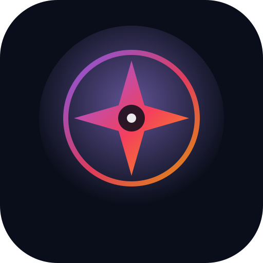
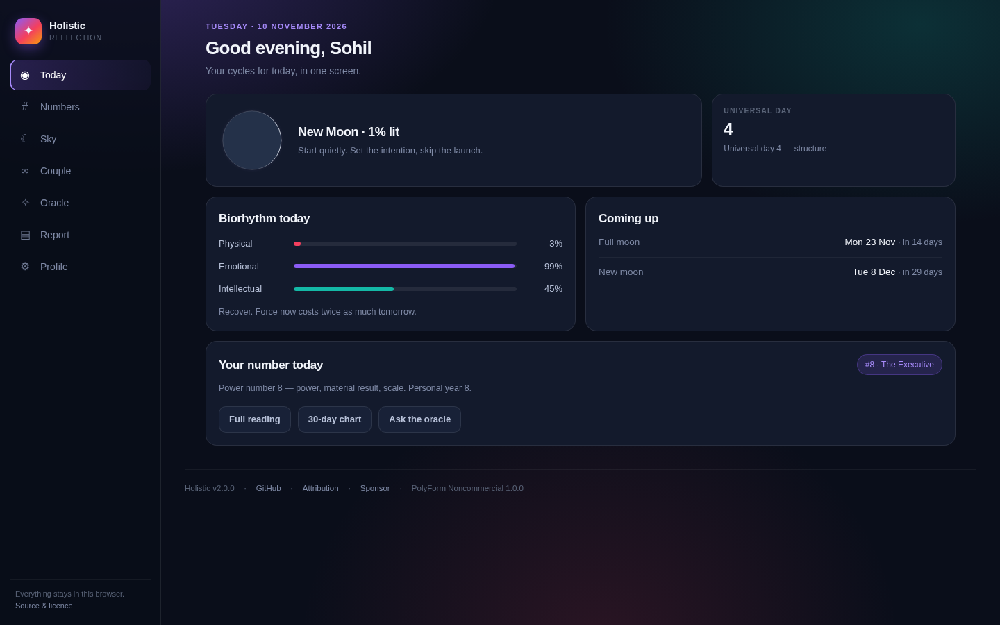
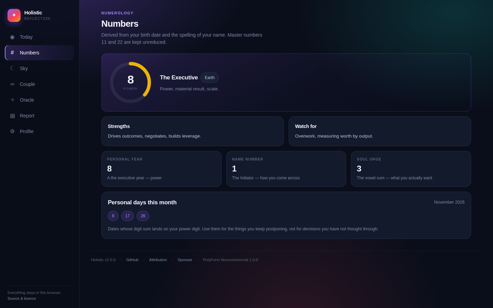
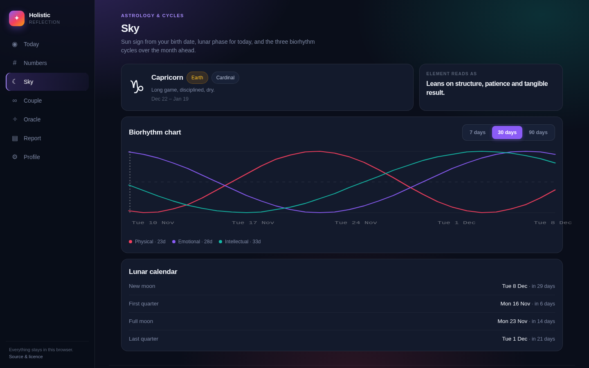
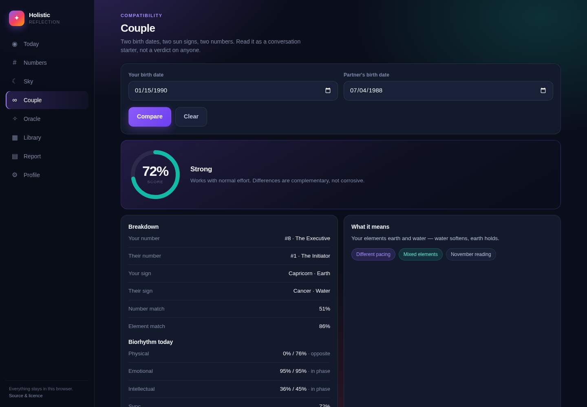
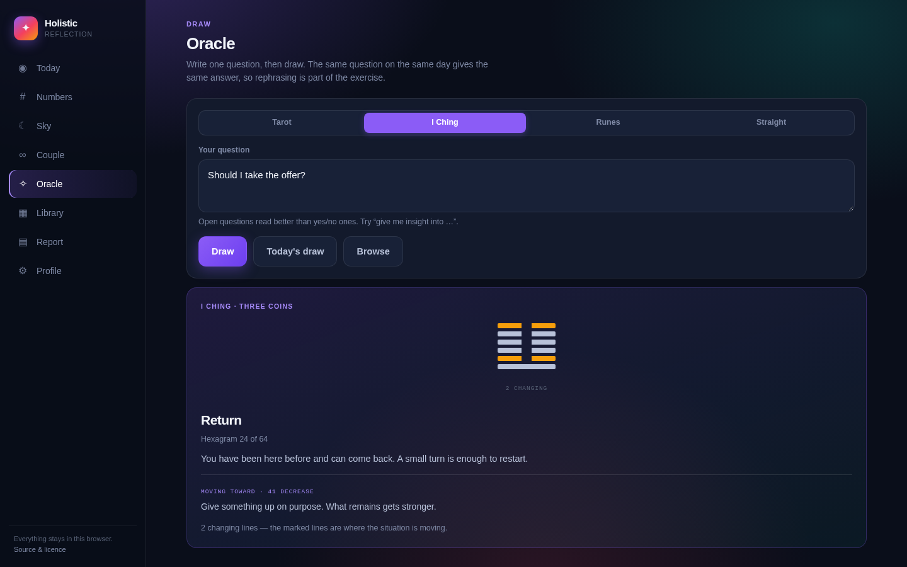
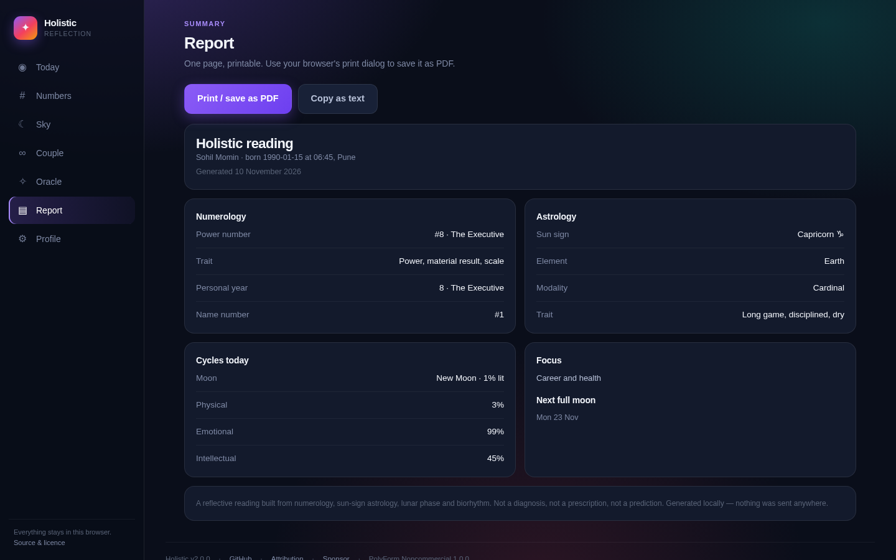
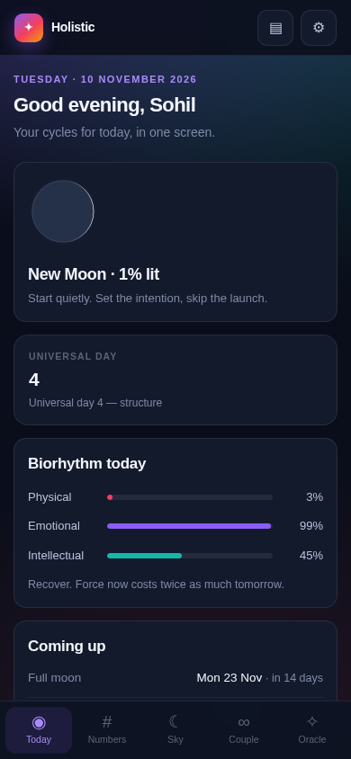
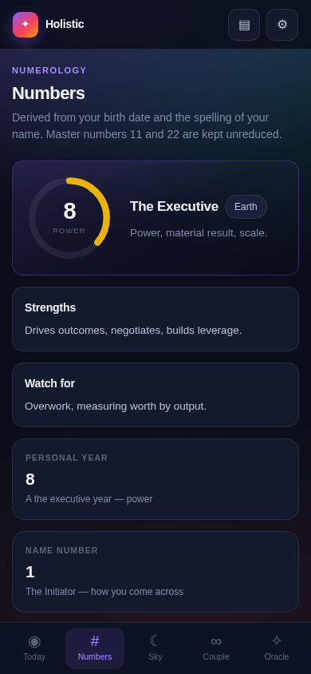
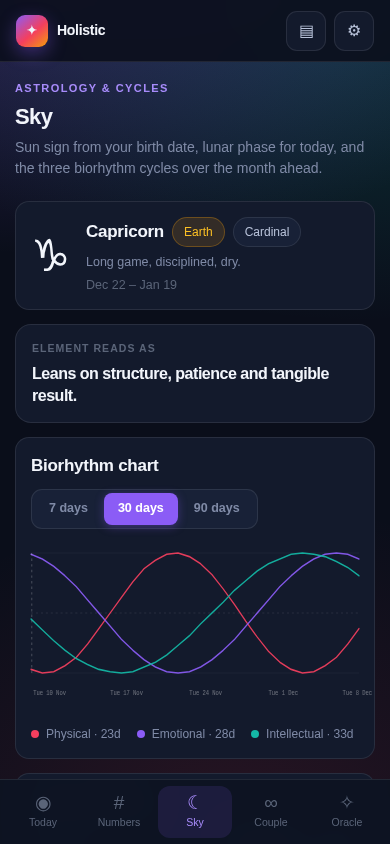

<div align="center">



# Holistic

**Eight traditions, one quiet app — numerology, astrology, a full I Ching, 78 tarot cards, runes, lunar phase and biorhythm. Offline and private.**

[](https://drsamonline.github.io/holistic/)
[](https://github.com/drsamonline/holistic/releases)
[](LICENSE)
[](#testing)
[](dist/holistic.html)
[](#privacy)



</div>

---

## What this is

A personal reflection app that runs entirely in your browser. You enter a name and a birth date once; it derives your numerology profile, your sun sign, today's lunar phase, and your biorhythm cycles, then keeps them on one screen you can open every morning.

It is **not** a dashboard of tables. Every number is computed from your input rather than looked up from a hard-coded list, and the whole thing — stylesheet, scripts, icons, logic — fits in a single 127 KB file that works with the Wi-Fi off.

## What it is not

Honesty is part of the product, so it is part of the README too.

| It is | It is not |
| --- | --- |
| A reflective exercise with a vocabulary for things you half-know | A diagnosis or a medical device |
| Arithmetic you can check by hand | Evidence — biorhythm in particular has failed validation since the 1970s |
| A reason to notice your own energy | A prediction of your future |
| Free and uncommercial | A prescription of anything, for anyone |

There is no homeopathy content in this project. An earlier prototype carried a remedy table derived from birth-date arithmetic; it was removed in v2.0.0 because a date of birth cannot select a constitutional remedy, and because a tool that names suicidal ideation in its output must route people to a human, not to a protocol.

## Screens

| | |
| --- | --- |
|  **Today** — moon, biorhythm, your number |  **Numbers** — power, personal year, name, personal days |
|  **Sky** — sun sign, 30-day chart, lunar calendar |  **Couple** — two dates, one honest read |
|  **Oracle** — a card, not a prophecy |  **Report** — one printable page |

<div align="center">



</div>

## Features

- **Numerology that computes.** Power number (11 and 22 preserved), personal year, Pythagorean expression number and soul urge from the letters of your name, and personal days derived for the current month.
- **Real lunar astronomy.** Phase, illumination and the next four phase dates from the synodic month, anchored to the new moon of 6 January 2000, 18:14 UTC.
- **Biorhythm chart.** 23 / 28 / 33-day cycles with a 7, 30 or 90-day view.
- **Couple reading.** Two dates, element relation, and a score that no longer penalises master numbers.
- **Full I Ching.** All 64 hexagrams, three-coin casting, changing lines read as a movement toward the transformed hexagram.
- **Full tarot.** All 78 cards — 22 majors and 56 minors — plus runes, the 24 Elder Futhark with reversed readings.
- **Library.** Every card, hexagram and rune, searchable, offline. 166 entries.
- **Oracle.** Tarot, I Ching, runes or a straight answer — seeded from your question, so the same question gives the same draw and rephrasing is part of the exercise.
- **Daily draw.** One card, hexagram or rune per day, fixed by the date so it cannot be re-rolled.
- **Printable report** plus a plain-text copy button.
- **Backup and restore** as a JSON file you own.
- **Installable PWA** with a service worker, and a single-file build for everything else.

## Privacy

- **No network requests at runtime.** No fonts, no CDN, no analytics, no telemetry. You can verify it: open DevTools → Network, use the app, and watch it stay empty.
- **One storage key** in `localStorage`, unencrypted, on your device. *Erase everything* in the Profile screen removes it.
- **No account, no sync, no server.** There is nothing to sign up for because there is no backend.

## Install

### 1 · Web / PWA

Open **[drsamonline.github.io/holistic/app](https://drsamonline.github.io/holistic/app/)** and use your browser's **Install** or **Add to Home Screen**. It caches itself and works offline afterwards.

The landing page is at **[drsamonline.github.io/holistic](https://drsamonline.github.io/holistic/)**. Both are published by the **Deploy site** workflow on every push to `main`.

### 2 · Single HTML file

Download `holistic.html` from the [latest release](https://github.com/drsamonline/holistic/releases/latest) and double-click it. Everything is inlined — it runs from a USB stick, an email attachment, or `file://` with no server.

```bash
npm run build     # regenerates dist/holistic.html from source
```

### 3 · App packages

The [v2.0.0 release](https://github.com/drsamonline/holistic/releases/tag/v2.0.0) ships both, built by CI from this source:

| Asset | Size | Notes |
| --- | --- | --- |
| `holistic-android.apk` | 4.3 MB | Capacitor debug build. Unsigned, so Android will ask you to allow installs from your browser or file manager. |
| `holistic-windows-setup.exe` | 78 MB | NSIS installer wrapping the single-file build in Electron. Unsigned, so SmartScreen will warn once. |

Rebuild them yourself with the **Build app packages** workflow (`workflow_dispatch`, or push to the `ci-packages` branch).

## Development

No build step, no dependencies, no framework. Four plain scripts loaded in order.

```bash
git clone https://github.com/drsamonline/holistic.git
cd holistic
python3 -m http.server 8080     # or: npm run serve
```

Open <http://localhost:8080>. Deep links work: `#today`, `#numbers`, `#sky`, `#couple`, `#oracle`, `#report`, `#profile`.

```
index.html                  the app shell
assets/css/app.css          one stylesheet, mobile-first
assets/js/data.js           static tables — no logic
assets/js/core.js           pure functions — importable in Node
assets/js/ui.js             rendering — no event handling
assets/js/app.js            state, routing, events, storage
landing/                    marketing page
scripts/                    build, screenshot and test harnesses
tests/core.test.mjs         54 logic tests
tests/harness/browser.js    87 in-browser assertions
sw.js · manifest.webmanifest
```

### Testing

```bash
npm test              # 54 logic tests, Node's built-in runner
npm run test:browser  # 102 DOM assertions in headless chromium
npm run build         # single-file bundle
```

The browser harness checks every screen, every action button, every navigation target, empty states, invalid input, all four oracle modes, the library and its search, and that no `getElementById` call misses.

## Roadmap

Deliberately short — the point is to stay small.

- [ ] Moon-sign and ascendant once birth time and city are used (they are collected but currently unused)
- [ ] Year-aware forecast, or the tab renamed to match what it does
- [ ] Optional light theme for printing
- [ ] Import/export of the whole history, not just the profile

## Attribution

Sources, traditions and their licences are listed in **[ATTRIBUTION.md](ATTRIBUTION.md)**. The lunar model follows the standard synodic-month calculation; letter values follow Pythagorean numerology; the tarot and I Ching texts are written for this project from the public-domain tradition.

## Licence

**[PolyForm Noncommercial 1.0.0](LICENSE)** — use, change and share it for any noncommercial purpose. Commercial use requires a separate licence. Copyright © 2026 Dr Sohil Momin.

## Sponsor

It stays free, uncommercial and ad-free. If it earned a place on your home screen:

[](https://github.com/sponsors/drsamonline)

## Author

**Dr Sohil Momin** — [@drsamonline](https://github.com/drsamonline)

Built as a reflective exercise, and shared in case it is useful to someone else.

> Not a medical device. If you are struggling with your mental health, please speak to a qualified professional.
